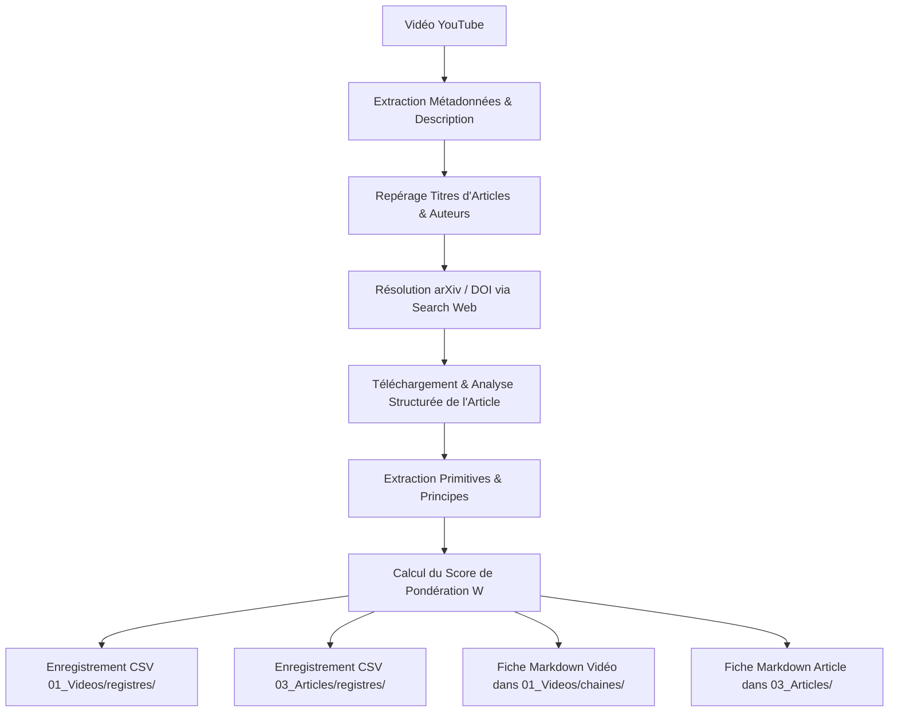

# MSCI Primitives, Principles & Weighting Engine (04_MS-CI)

Ce Skill formalise le pipeline d'ingestion et de distillation de vidéos scientifiques et techniques au sein du pôle `04_MetaScience_CooperativeIntelligence` (`04_MS-CI`). Il transforme des contenus vidéo denses en **primitives atomiques**, **principes invariants** et **scores de pondération opérationnelle**, tout en reliant systématiquement chaque vidéo aux **articles de recherche originaux** (arXiv, IEEE, ACM, Nature, Science).

---

## 1. Modèle Mathématique de Pondération Composite ($W_{composite}$)

Chaque concept ou découverte extrait d'une vidéo est pondéré selon un vecteur à 4 dimensions normalisées $[0, 1]$ :

$$W_{composite} = w_R \cdot R + w_E \cdot E + w_A \cdot A + w_H \cdot H$$

Où les poids par défaut sont configurés pour sanctuariser la fiabilité agentique :
- **$R$ (Rigueur Épistémique / Preuve Formelle, $w_R = 0.30$)** : Modèle mathématique prouvé, benchmark reproductible, publication révisée par les pairs (ex. arXiv, Caltech, NVIDIA, Berkeley).
- **$E$ (Preuve Empirique / Benchmark Réel, $w_E = 0.25$)** : Mesure sur modèles ouverts ou production (gain de latence, réduction du cache KV, rétention SWE-bench).
- **$A$ (Actionnabilité Déterministe, $w_A = 0.25$)** : Faisabilité d'implémentation immédiate sans modifier le hardware ou sans ré-entraînement lourd (ex. compaction de contexte, MetaTokens, filtres d'attention).
- **$H$ (Pertinence Holonique Aspace OS V5, $w_H = 0.20$)** : Impact direct sur les 3 OS (Tech OS, Life OS 2026, Areas OS) ou le Jumeau Numérique A0 Amadeus.

### Classification par Seuil de Décision
- **Tier 1 — Core Invariant ($W_{composite} \ge 0.85$)** : Intégration immédiate dans les contrats système (`AGENTS.md`, `CLAUDE.md`, spine usine).
- **Tier 2 — Architecture Reference ($0.70 \le W_{composite} < 0.85$)** : Fiche concept dans `00_Memoire/bundle/concepts/` et registre `articles_index.csv`.
- **Tier 3 — Observational Evidence ($W_{composite} < 0.70$)** : Archivage en lecture seule dans les logs et répertoires d'observation.

---

## 2. Extraction Structurée des Primitives et Principes

### A. Qu'est-ce qu'une Primitive ?
Une **primitive** est l'unité conceptuelle indivisible de calcul, d'état ou d'interaction :
- *Exemples* : Tensor Core, MetaToken, KV-cache partagé, voisinage topologique $k=7$, liaison stérique 3D, graphe orienté de citations, fenêtre glissante partielle.

### B. Qu'est-ce qu'un Principe ?
Un **principe** est la loi relationnelle ou dynamique qui régit l'évolution des primitives dans le temps :
- *Exemples* :
  - *Loi de Vicsek* : L'alignement local produit une transition de phase critique vers la synchronisation collective.
  - *Loi de Compaction Belcak-NVIDIA* : Les fenêtres de contexte courtes compactées par handoff préservent l'exactitude tout en divisant les coûts par $3.6\times$ à $7\times$.
  - *Loi de Stale Binding de Berkeley* : La dérive d'attention vers les valeurs obsolètes est un échec de sélection réversible par réalignement d'attention.

---

## 3. Protocole Opérationnel d'Exécution

### Étape 1 : Récupération des Métadonnées & Sources
1. Extraire le titre, l'auteur, et la description brute via oEmbed ou parsing de page.
2. Isoler les citations formelles d'articles (auteurs, institutions, titres exacts).

### Étape 2 : Résolution Bibliographique & Filiation
1. Localiser l'URL pérenne (arXiv, ACM Digital Library, IEEE Xplore, Semantic Scholar).
2. Vérifier l'identifiant canonique (ex. `arXiv:2609.38866`).

### Étape 3 : Fiches Markdown Conventionnées
- Créer la fiche vidéo dans `04_MetaScience_CooperativeIntelligence/01_Videos/chaines/<chaine>/<titre_slug>.md`.
- Créer la fiche article dans `04_MetaScience_CooperativeIntelligence/03_Articles/<article_slug>.md`.
- Lier bidirectionnellement par chemin relatif `file://` ou markdown local.

### Étape 4 : Registres Tabulaires RFC 4180
- Ajouter/mettre à jour `chaines_youtube.csv`, `playlists.csv`, `videos_index.csv`, `articles_index.csv`.
