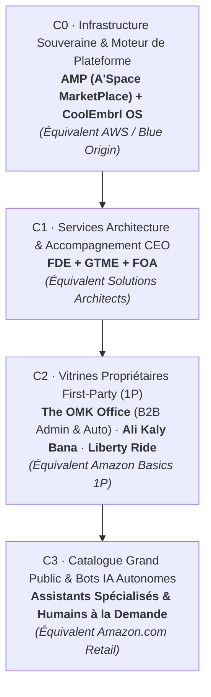

# B1-BOOK — OwnerBook B1 · Carrière & Business (AMP A'Space MarketPlace [C0] × The OMK Office [C2 1P] / SOB / Concordia)

- **Domaine (`Area`)** : `LD01` (Carrière & Business : Moteur de Plateforme C0 AMP & Vitrine 1P C2 The OMK Office)
- **Colonne Holonique** : `B` (`B1` Directeur -> `B2` 8 Managers DC -> `B3` 8 Squads Marvel)
- **Ancrage PARA (`Life OS`)** : `24_PARA_Enterprise` (`Troi` Areas) × `22_Wheel_Discovery` (`Book`)
- **Garde-Fou (`Gatekeeper`)** : A1-Morty (Read-back GWS & Fencing Token TTL 300s, ADR-004 US Geo-Fencing)

---

## Pyramide Holonique des 4 Strates Commerciales (C0 → C3)

- **Moteur de Plateforme (C0)** : [Aspace_MarketPlace/](Aspace_MarketPlace/) — Master Plan, Mission, Specs, Design, Roadmap, PRD, BMC.
- **Vitrine Propriétaire 1P (C2)** : [The_OMK_Office/](The_OMK_Office/) — Offres B2B, Services d'automatisation, Proof-First Cohorte 25.
- **Règles d'Exclusion & Juridiction** : ADR-004 (`Cincinnati / Northern Kentucky Metro`, interdiction formelle France & UE).
