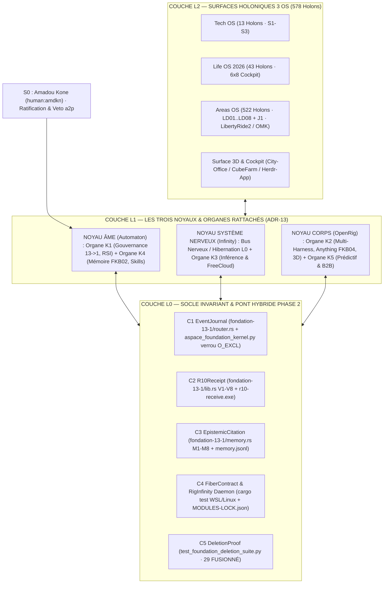

# SDD-FONDATION — Architecture Technique en 3 Couches & 3 Noyaux (`ADR-13`)

## 1. Vue d'Ensemble & Trajectoire `Python → Hybride → Rust`

---

## 2. Couche L0 — Socle Invariant & État Vérifié Cycle 4

| Composant L0 | Chemin exact dans le dépôt | Langage / Runtime | État vérifié Cycle 4 |
|---|---|---|---|
| **Fondation 13→1** | `01_Forkable/FKB00_Runtime/00_A0_Core/fondation-13-1/` | Rust (0 dépendance) | **Compilé & VERT 100/100** (`cargo test` Windows/GNU après `.gitattributes` `eol=lf` sur fixtures) ; 6 binaires compilés (`r10-receive`, `route-dispatch`, `recall-fact`, ...) ; fonctions `F1-8..F1-11` restantes (`PARTIEL`) |
| **RigInfinity Daemon** | `01_Forkable/FKB00_Runtime/01_Holo_TriptyqueCore/RigInfinity` | Rust (`crates/infinity-daemon`) | **Compilé & VERT 105/105** sous WSL2 `UmbrelOS` Linux (`cargo test`, POSIX `UnixListener` / PTY / signaux) ; les **9 modules F8** portés sont validés ; `gitlink 160000` + `lease/dispose` restent (`PARTIEL`) |
| **Noyau L0/L1 & Pont Phase 2** | `01_Forkable/FKB00_Runtime/00_A0_Core/aspace_foundation_kernel.py` | Python ↔ Binaires Rust | **ACTIF PHASE 2 HYBRIDE** : verrou atomique `O_EXCL` sur JSONL L0, zéro wrap `% 1000`, parité 1:1 prouvée par invocation directe des binaires Rust `r10-receive` et `route-dispatch` sur `anchor-001/002/026` |
| **AspaceFiberHost** | `01_Forkable/FKB00_Runtime/00_A0_Core/aspace-fiber-host/` | TypeScript / Vitest | **`PARTIEL`** (`file:../cordis/*` et `cordis_socket` vers `RigInfinity` restants) |
| **Verrou & Gates Usine** | `01_Forkable/MODULES-LOCK.json` + `02_Factory/checks.ps1` | Python / PowerShell | **VERT** (6/6 `check-modules-lock.py` ; 7/7 `checks.ps1` ; `CARGO_HOME`/`RUSTUP_HOME` auto-réparés dans `doctor.ps1`) |

---

## 3. Couche L1 — Câblage Effectif des Trois Noyaux (`ADR-13`)

### 3.1 `NOYAU ÂME` (`Automaton` — Organes `K1` et `K4`)
- **Organe `K1`** : `01_Forkable/FKB00_Runtime/00_A0_Core/a0_recursive_factory.py` (orchestration RLM, WikiSkill gate `δ ≥ 1.7 %`, Dream-RSI) câblé sur `EventJournal` + `R10Ledger`.
- **Organe `K4`** :
  - `01_Forkable/FKB00_Runtime/00_A0_Core/aspace_fkb02_memory_organ.py` (absorbe les **9 modules `FKB02_Memory`** : `HierarchicalCASStore`, `AutoOntologyCompiler` DAG+contradictions, `build_clm_anchored_context`, `validate_dox_contract`, `HybridBrainIndex` BM25+n-gram+graphe+`M1-M8`, `ASTCodeGraphBuilder`, `MultiBrainNamespaceManager`, `validate_okf_bundle`).
  - `01_Forkable/FKB02_Memory/01_BillionContxtLanguage_AutoOnthology/neuro_symbolic_bridge.py` (`memory.jsonl`).
  - Primitives `caveman`, `claude-mem`, `hermes-agent` portées dans `aspace_fkb04_anything_organ.py`.

### 3.2 `NOYAU SYSTÈME NERVEUX` (`Infinity` — Bus Nerveux L0 & Organe `K3`)
- **Bus Nerveux & Fibres** : `RigInfinity` (`crates/infinity-daemon` : hibernation pure-data, `RAP`, `MCP proxy`, `openrig_terminal.rs`), `aspace_foundation_kernel.py` (`l0_foundation_journal.jsonl`, `l0_foundation_ledger.jsonl` sous verrou `O_EXCL`).
- **Organe `K3`** :
  - `01_Forkable/FKB01_Inference/03_Inference_FreeCloud/aspace_freecloud_gateway.py` (initialisation SQLite **paresseuse** via `get_ledger()`/`get_router()`, port `:31415`).
  - `01_Forkable/FKB00_Runtime/00_A0_Core/aspace_discovery_catalog.py` (absorbe `M118 04_Inference_Youtube_Discovery_Registry` en code natif hors répertoire source).

### 3.3 `NOYAU CORPS` (`OpenRig` — Organes `K2` et `K5`)
- **Organe `K2`** :
  - `01_Forkable/FKB00_Runtime/00_A0_Core/aspace_freecompute_router.py` (routage exécution sans `FreeVPS`).
  - `01_Forkable/FKB00_Runtime/00_A0_Core/aspace_fkb04_anything_organ.py` (absorbe `CLI-Anything`, `agent-browser` `@ref` + garde anti-CAPTCHA, `agent-desktop` `no_focus_steal`, `api-anything` HAR->MCP, `rea` inspection clean-room D12).
- **Organe `K5`** :
  - `01_Forkable/FKB07_Money_Maker/aspace_marketplace_engine.py` + `02_Video/aspace_video_studio_foundation.py` + `aspace_discovery_catalog.py` (`M117 00_Marketplace_YoutubeSkills` absorbé nativement) + `02_PredictiveWargame_MachineLearning/{triptych_autogluon_engine,wargame_tabular_engine}.py`.
