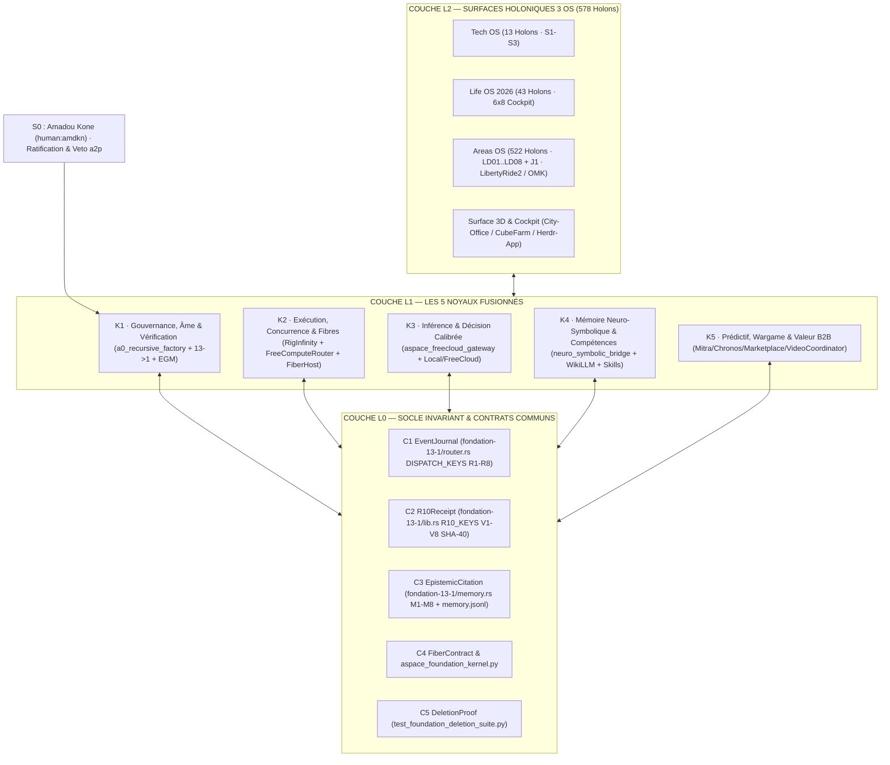

# SDD-FONDATION — Architecture Technique en 3 Couches (L0 / L1 / L2)

## 1. Vue d'Ensemble & Interconnexion Fondamentale

---

## 2. Couche L0 — Socle Invariant & État Réel des Implémentations

| Composant L0 | Chemin exact dans le dépôt | Langage / Runtime | État vérifié Cycle 2 |
|---|---|---|---|
| **Fondation 13→1** | `01_Forkable/FKB00_Runtime/00_A0_Core/fondation-13-1/` | Rust (0 dépendance) | **`PARTIEL`** (`F1-2..F1-7` implémentés ; `F1-8..F1-11` restants ; `cargo` absent sur la VM locale pour compilation/test direct) |
| **Noyau d'Interconnexion L0/L1** | `01_Forkable/FKB00_Runtime/00_A0_Core/aspace_foundation_kernel.py` | Python Stdlib (0 dep) | **ACTIF & ALIGNÉ 1:1** sur `lib.rs`, `router.rs`, `memory.rs` (`R10_KEYS`, `DISPATCH_KEYS`, `FUNCTIONS_13`, `M1–M8`) ; importé directement par les 5 Noyaux `K1..K5` |
| **AspaceFiberHost** | `01_Forkable/FKB00_Runtime/00_A0_Core/aspace-fiber-host/` | TypeScript / Vitest | **`PARTIEL`** (`package.json` référence encore `file:../cordis/*` à internaliser ; socket Unix `cordis_socket` vers `RigInfinity` `PENDING`) |
| **RigInfinity Daemon** | `01_Forkable/FKB00_Runtime/01_Holo_TriptyqueCore/RigInfinity` | Rust (`crates/infinity-daemon`) | **`PARTIEL`** (9/11 modules F8 portés ; gitlink `160000` encore actif ; `lease/dispose/health/rollback/cordis_host` = `PENDING`) |
| **Verrou & Registre Capacités** | `01_Forkable/MODULES-LOCK.json` + `check-modules-lock.py` | JSON + Python | **VERT** (Vérifications 1–6 passent à 100 %) |
| **Factory Spine & SQLite** | `02_Factory/factory.ps1` + `02_Factory/checks.ps1` | PowerShell / SQLite / Python | **VERT** (7/7 gates passent ; `.semantic_gate.py` couvre Core hors `01_Forkable`) |

---

## 3. Couche L1 — Câblage Effectif des 5 Noyaux sur L0 (`aspace_foundation_kernel.py`)

### 3.1 K1 — Gouvernance, Âme & Vérification
- **Fichier câblé** : `01_Forkable/FKB00_Runtime/00_A0_Core/a0_recursive_factory.py` importe `EventJournal`, `R10Ledger`, `FoundationKernelRegistry` et émet un événement `DISPATCH_KEYS` (`structurer -> verifier`) + un reçu `aspace.r10-receipt.v1` pour chaque cycle RLM/WikiSkill/Dream-RSI.

### 3.2 K2 — Exécution, Concurrence & Surface Vivante
- **Fichier câblé** : `01_Forkable/FKB00_Runtime/00_A0_Core/aspace_freecompute_router.py` importe `aspace_foundation_kernel` pour consigner les décisions de routage d'exécution et purge le provider `github-actions-freevps` (ADR-08).
- **Dette nommée** : câblage socket Unix `AspaceFiberHost <-> RigInfinity` et baux Automaton `lease/dispose` restent à implémenter dans `RigInfinity`.

### 3.3 K3 — Inférence & Décision Calibrée
- **Fichier câblé** : `01_Forkable/FKB01_Inference/03_Inference_FreeCloud/aspace_freecloud_gateway.py` importe `aspace_foundation_kernel` pour tracer les dispatches de complétion et reçus R10 sur le pool SQLite `egm_missions.db` (`:31415`).

### 3.4 K4 — Mémoire Neuro-Symbolique & Compétences
- **Fichier câblé** : `01_Forkable/FKB02_Memory/01_BillionContxtLanguage_AutoOnthology/neuro_symbolic_bridge.py` remplace l'extraction statique par un extracteur dynamique du contenu (`compile_ontology(chunk)` générant entités, liens DAG vérifiés acycliques et empreinte CAS) couplé à `EventJournal`, `R10Ledger` et `validate_citation` (`M1–M8`).

### 3.5 K5 — Prédictif, Wargame & Moteurs de Valeur B2B
- **Fichiers câblés** :
  - `01_Forkable/FKB07_Money_Maker/aspace_marketplace_engine.py` importe `aspace_foundation_kernel` pour émettre un reçu `aspace.r10-receipt.v1` et un événement `dispatch_typed` par commande client.
  - `01_Forkable/FKB07_Money_Maker/02_Video/aspace_video_studio_foundation.py` audite l'état réel sur disque des 10 moteurs vidéo canoniques (F4) et émet le manifeste de pipeline + reçu L0 sans prétendre remplacer leur binaire de rendu (les 10 moteurs vidéo restent honnêtement classés `PARTIEL`).
  - `02_PredictiveWargame_MachineLearning/{triptych_autogluon_engine,wargame_tabular_engine}.py` maintiennent l'isolation stricte de licences (`b2b_commercial` Apache-2.0 vs `a0_internal_wargame`).
