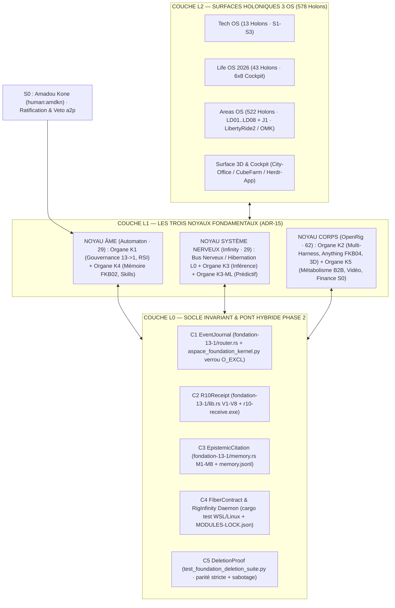

# SDD-FONDATION — Architecture Technique en 3 Couches & 3 Noyaux (`ADR-13`)

## 1. Vue d'Ensemble & Trajectoire `Python → Hybride → Rust`

---

## 2. Couche L0 — Socle Invariant & État Vérifié Cycle 6

| Composant L0 | Chemin exact dans le dépôt | Langage / Runtime | État vérifié Cycle 6 |
|---|---|---|---|
| **Fondation 13→1** | `01_Forkable/FKB00_Runtime/00_A0_Core/fondation-13-1/` | Rust (0 dépendance) | **Compilé & VERT 100/100** (`cargo test` Windows/GNU après `.gitattributes` `eol=lf` sur fixtures) ; 6 binaires compilés (`r10-receive`, `route-dispatch`, `recall-fact`, ...) ; fonctions `F1-8..F1-11` restantes (`PARTIEL`) |
| **RigInfinity Daemon** | `01_Forkable/FKB00_Runtime/01_Holo_TriptyqueCore/RigInfinity` | Rust (`crates/infinity-daemon`) | **Compilé & VERT 105/105** sous WSL2 `UmbrelOS` Linux (`cargo test`, POSIX `UnixListener` / PTY / signaux) ; les **9 modules F8** portés sont validés ; `gitlink 160000` + `lease/dispose` restent (`PARTIEL`) |
| **Noyau L0/L1 & Pont Phase 2** | `01_Forkable/FKB00_Runtime/00_A0_Core/aspace_foundation_kernel.py` | Python ↔ Binaires Rust | **ACTIF PHASE 2 HYBRIDE** : `ROOT_KERNELS` (3 noyaux `ÂME / SYSTÈME NERVEUX / CORPS`), helper partagé `consign_measured_l0_evidence(...)`, verrou atomique `O_EXCL` sur JSONL L0, parité 1:1 Rust sur `anchor-001/002/026` |
| **AspaceFiberHost** | `01_Forkable/FKB00_Runtime/00_A0_Core/aspace-fiber-host/` | TypeScript / Vitest | **`PARTIEL`** (`file:../cordis/*` et `cordis_socket` vers `RigInfinity` restants) |
| **Verrou & Gates Usine** | `01_Forkable/MODULES-LOCK.json` + `02_Factory/checks.ps1` | Python / PowerShell | **VERT** (6/6 `check-modules-lock.py` ; 7/7 `checks.ps1` ; `CARGO_HOME`/`RUSTUP_HOME` auto-réparés dans `doctor.ps1`) |

---

## 3. Couche L1 — Câblage Effectif des Trois Noyaux (`ADR-15`)

### 3.1 `NOYAU ÂME` (`Automaton` · 29 modules — Organes `K1` et `K4`)
- **Organe `K1`** : `01_Forkable/FKB00_Runtime/00_A0_Core/a0_recursive_factory.py` (orchestration RLM, WikiSkill gate `δ ≥ 1.7 %`, Dream-RSI) câblé sur `EventJournal` + `R10Ledger`.
- **Organe `K4`** :
  - `01_Forkable/FKB00_Runtime/00_A0_Core/aspace_fkb02_memory_organ.py` (portage 1:1 différentiellement prouvé + anti-sabotage pour `M044 context-language-models` [`context_string`, `edit_gate`, `finish_policy`, `lm_compat`] et `M050 knowledge-catalog` [`document`, `index`, `synthesizer`, `paths`] ; implémentations natives complémentaires `FKB02_Memory` = `PARTIEL`). Reçus R10 mesurés dynamiquement sans compteur figé (`consign_fkb02_parity_receipt`).
  - `01_Forkable/FKB02_Memory/01_BillionContxtLanguage_AutoOnthology/neuro_symbolic_bridge.py` (`memory.jsonl`).
  - Primitives `caveman`, `claude-mem`, `hermes-agent` (`PARTIEL`) portées dans `aspace_fkb04_anything_organ.py`.

### 3.2 `NOYAU SYSTÈME NERVEUX` (`Infinity` · 29 modules — Bus Nerveux L0, Organes `K3` et `K3-ML`)
- **Bus Nerveux & Fibres (7)** : `RigInfinity` (`crates/infinity-daemon` : hibernation pure-data, `RAP`, `MCP proxy`, `openrig_terminal.rs`), `aspace_foundation_kernel.py` (`l0_foundation_journal.jsonl`, `l0_foundation_ledger.jsonl` sous verrou `O_EXCL`).
- **Organe `K3` (15)** :
  - `01_Forkable/FKB01_Inference/03_Inference_FreeCloud/aspace_freecloud_gateway.py` (initialisation SQLite **paresseuse** via `get_ledger()`/`get_router()`, port `:31415`).
  - `01_Forkable/FKB00_Runtime/00_A0_Core/aspace_discovery_catalog.py` (absorbe `M118 04_Inference_Youtube_Discovery_Registry` + `OPPORTUNITY_DOSSIERS` `OPP-001..005` en parité stricte sans clé en trop et détection de sabotage).
- **Organe `K3-ML` — Cortex Prédictif & Wargame (7)** : `02_PredictiveWargame_MachineLearning/{triptych_autogluon_engine,wargame_tabular_engine}.py` (`MiroFish`, `PathFM`, `autogluon`, `chronos-forecasting`, `mitra-2`, `tabfm`, `timesfm`).

### 3.3 `NOYAU CORPS` (`OpenRig` · 62 modules — Organes `K2` et `K5 · Métabolisme`)
- **Organe `K2` (26)** :
  - `01_Forkable/FKB00_Runtime/00_A0_Core/aspace_freecompute_router.py` (routage exécution sans `FreeVPS`).
  - `01_Forkable/FKB00_Runtime/00_A0_Core/aspace_fkb04_anything_organ.py` : portage 1:1 différentiellement prouvé + sabotage pour `M056 CLI-Anything` (`extract_commands_from_cli`, `extract_cli_anything_metadata`, `generate_cli_anything_skill_md`, `generate_cli_anything_skill_md_simple`, `build_cli_anything_preview_cache_key`) ; pilote UIA `M058 agent-desktop` sans repli `headless-fallback` (`live_window_verified = False`, `PARTIEL`) ; primitives `agent-browser`, `api-anything`, `rea` (`PARTIEL`).
- **Organe `K5` — Métabolisme B2B, Studio Vidéo & Finance S0 (36)** :
  - `01_Forkable/FKB07_Money_Maker/aspace_marketplace_engine.py` + `02_Video/aspace_video_studio_foundation.py` (portage 1:1 différentiel + sabotage de **`M095 video-director`** : `check_timeline.py` + fonctions `qa_video.py`, `consign_video_director_parity_receipt`) + `aspace_discovery_catalog.py` (`M117 00_Marketplace_YoutubeSkills` en parité stricte + sabotage) + `LibertyRide2` (`RETENU`).
