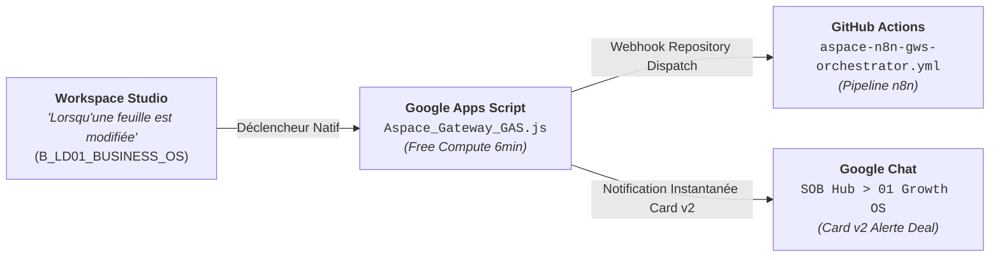

# Guide de Déploiement : Passerelle Apps Script & Workspace Studio (Option 2)

> **Objectif** : Activer le compute Cloud Google gratuit (6 min/run, 90 min CPU/jour) via le projet Apps Script visible sur ta capture (`1z3Ffl39OGqwFUf2kA4...`) et ton flux Workspace Studio (`studio.workspace.google.com/u/0/workflow/dbf9a6...`).

---

## Étape 1 · Injecter le Script dans `script.google.com`

1. Rends-toi sur ton projet Apps Script ouvert sur ta capture :
   👉 **URL** : `https://script.google.com/home/projects/1z3Ffl39OGqwFUf2kA4_rC9d2f2QYvK3_sX1w/edit`
2. Dans le fichier `Code.gs` (qui contient actuellement `function myFunction() {}`), supprime tout et colle l'intégralité du fichier :
   👉 [`02_Factory/gas/Aspace_Gateway_GAS.js`](file:///c:/Users/amado/Aspace%20OS%20V5/02_Factory/gas/Aspace_Gateway_GAS.js)
3. Clique sur la disquette **Enregistrer** (ou `Ctrl + S`).
4. **Test immédiat** : Dans le menu déroulant de fonction en haut, sélectionne `test_SheetEditTrigger` et clique sur **Exécuter**.  
   Vérifie dans le *Journal d'exécution* en bas que le test affiche `[SUCCÈS] Workspace Studio Trigger Executed`.

---

## Étape 2 · Déployer comme Application Web

1. En haut à droite, clique sur le bouton bleu **Déployer > Nouveau déploiement**.
2. Clique sur l'icône d'engrenage à gauche de *Sélectionner le type* et choisis **Application Web**.
3. Renseigne les paramètres :
   - **Description** : `Aspace Gateway V5 - Workspace Studio & GChat Bridge`
   - **Exécuter en tant que** : `Moi (tonadresse@gmail.com)`
   - **Qui a accès** : `Tout le monde` (ou `Moi-même`)
4. Clique sur **Déployer** et copie l'**URL de l'application Web** (`https://script.google.com/macros/s/.../exec`).

---

## Étape 3 · Configurer les Secrets dans Apps Script

Dans le volet de gauche d'Apps Script :
1. Clique sur l'icône d'engrenage **Paramètres du projet** (en bas à gauche).
2. Fais défiler jusqu'à **Propriétés du script** et clique sur **Ajouter une propriété de script** :

| Propriété | Valeur | Description |
|---|---|---|
| `GITHUB_WORKFLOW_PAT` | `ghp_ton_token_github...` | Token GitHub (Personal Access Token) avec scope `repo` pour déclencher GitHub Actions. |
| `GCHAT_GROWTH_OS_WEBHOOK` | `https://chat.googleapis.com/v1/spaces/.../messages?key=...` | Webhook URL de ton espace Google Chat `SOB Hub > 01 Growth OS` (ou `App, tech, collect...`). |

---

## Étape 4 · Raccorder le Déclencheur dans Workspace Studio

Rends-toi sur l'onglet de ta capture **Workspace Studio** :
👉 **URL** : `https://studio.workspace.google.com/u/0/workflow/dbf9a6...`

1. **Déclencheur (Choisir un déclencheur)** :
   - Sélectionne la tuile verte : **« Lorsqu'une feuille est modifiée »**.
   - Choisis le classeur : `00 — LIFE OS 2026 · Cockpit 6 Frameworks × 8 Domaines`.
   - Feuille cible : `B_LD01_BUSINESS_OS`.
2. **Action (Choisir une étape)** :
   - Choisis **« Exécuter un script Apps Script »** $\rightarrow$ Sélectionne `Aspace_Gateway_GAS` $\rightarrow$ Fonction `onWorkspaceStudioSheetEdit`.
   - *(Option alternative)* : Choisis **« Envoyer un webhook »** $\rightarrow$ Colle l'URL de l'Application Web générée à l'Étape 2.
3. Clique sur **Tester l'exécution**, puis sur **Activer** (bouton en bas).

---

## Résultat Opérationnel

Dès qu'une modification survient dans l'onglet `B_LD01_BUSINESS_OS` (ex. mise à jour d'un statut de prospect de la Cohorte 25 de `AUDIT_READY_PROOF_FIRST` à `MESSAGE_SENT` ou `CALL_SCHEDULED`) :
1. **Workspace Studio** capte l'événement instantanément.
2. **Google Apps Script** s'exécute gratuitement sur les quotas Cloud Google (zéro coût).
3. **GitHub Actions** déclenche le workflow n8n [`aspace-n8n-gws-orchestrator.yml`](file:///c:/Users/amado/Aspace%20OS%20V5/.github/workflows/aspace-n8n-gws-orchestrator.yml).
4. **Google Chat** reçoit une notification Card v2 interactive avec boutons d'action dans `SOB Hub > 01 Growth OS`.
