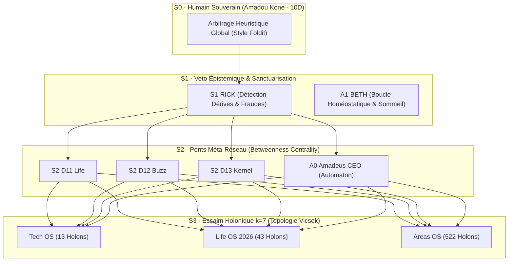

# Synthèse Méta-Scientifique : Lois de l'Intelligence Collective & des Réseaux Coopératifs

> **Théorie Unifiée** issue des analyses de Fouloscopie (Mehdi Moussaïd) : Graphes de recherche séculaires, calcul distribué citoyen et physique des essaims sans chef.

---

## 1. La Trinité de l'Intelligence Collective

| Dimension | Mécanisme Fondamental (Fouloscopie) | Formulation Mathématique / Topologique | Équivalent Aspace OS V5 |
|---|---|---|---|
| **Structure du Réseau** | Graphes de citations séculaires & percolation | $L \sim \ln N$ (distance courte) + composante connexe géante | Graphe de connaissances WikiLLM (`memory.jsonl` + Graphify) |
| **Résolution de Problèmes** | Symbiose Humain-Machine (Foldit / EyeWire) | Heuristique globale $H_{3D}$ $\times$ Descente locale $\nabla E$ | Posture 10D Amadou Kone (S0) $\times$ Workers dsh/pi/orca |
| **Coordination Sans Chef** | Essaims, Boids & Modèle de Vicsek | Règle topologique $k=7$ voisins + transition de phase critique | Alignement des 578 holons dans Cube Farm |

---

## 2. Les 4 Lois Invariant de Coordination Distribuée

### Loi 1 : Invariance d'Échelle par Interaction Topologique ($k$-Voisins)
Pour maintenir un essaim de centaines ou de milliers d'agents synchronisé sans saturer la bande passante ni la mémoire :
- Ne jamais tenter un broadcast $O(N^2)$ à tous les agents.
- Ne pas borner l'interaction à un rayon métrique arbitraire.
- Connecter chaque agent à ses **$k=7$ pairs fonctionnels immédiats**. La structure résiste alors à toutes les variations d'échelle (scalabilité universelle).

### Loi 2 : Le Seuil de Percolation et l'Évitement des Silos
- Un système d'agents fragmenté en petites équipes étanches est inefficace.
- L'introduction de quelques arêtes transversales à haute centralité d'intermédiarité (*betweenness centrality*) fait percoler le graphe et fait émerger la **composante géante d'intelligence coopérative**.
- Dans Aspace OS V5, les coordinateurs Doctor (`S2-D11`, `S2-D12`, `S2-D13`) et le Jumeau Numérique CEO 24/7 (`A0 Amadeus`) jouent exactement ce rôle de pont inter-domaines.

### Loi 3 : Décomposition en Micro-Tâches Spatialement Explicites
- L'homme n'excelle pas dans l'évaluation de millions de permutations textuelles abstraites.
- En convertissant un défi complexe en **environnement spatial visuel** (comme Cube Farm 3D ou les protéines 3D de Foldit), l'humain superviseur et les agents détectent instantanément les anomalies géométriques et organisationnelles.

### Loi 4 : L'Onde de Panique Réflective (Self-Healing Rapide)
- En cas de collision ou de menace (panne système, rupture de quota, test rouge), l'information ne doit pas attendre un rapport hiérarchique pyramidal.
- Elle se propage par onde de cisaillement locale immédiate, activant le failover automatique du pool de modèles et le verrouillage de worktree avant que la corruption ne contamine l'essaim.

---

## 3. Matrice d'Application aux 3 OS Holoniques

